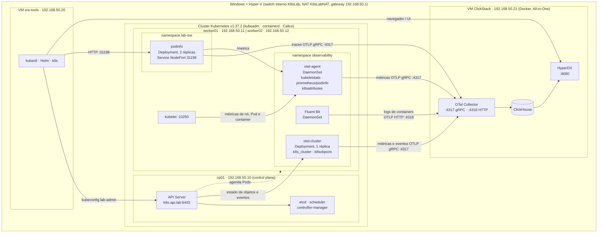

# k8s-lab — laboratório de Kubernetes para estudos de SRE

Laboratório doméstico para praticar instalação, operação e observabilidade de um cluster Kubernetes. O cluster é montado do zero com `kubeadm` em VMs Ubuntu Server LTS no Hyper-V (Windows, processador AMD, cerca de 20 GB de RAM livres). O foco é SRE: observar o comportamento do serviço, detectar problemas e recuperar a operação.

A proposta completa, com a trilha de estudos (recursos, autoscaling, Helm chart próprio, SLOs, incidentes e alta disponibilidade), está em [`lab/proposta.md`](lab/proposta.md).

## Arquitetura



### Máquinas virtuais

| VM | IP | Função | vCPU | RAM |
| --- | --- | --- | --- | --- |
| `cp01` | `192.168.50.10` | Control plane (API Server, etcd, scheduler, controllers) | 2 | 2 GB |
| `worker01` | `192.168.50.11` | Workloads e agentes do cluster | 2 | 4 GB |
| `worker02` | `192.168.50.12` | Workloads e agentes do cluster | 2 | 4 GB |
| `sre-tools` | `192.168.50.20` | Administração: `kubectl`, Helm, `k9s`, testes de carga | 1 | 2 GB |
| ClickStack | `192.168.50.21` | Observabilidade: OTel Collector, ClickHouse, HyperDX | — | 6 GB |

Todas as VMs ficam na rede `192.168.50.0/24`, atrás do switch interno `K8sLab` com NAT (`K8sLabNAT`), usando o Windows (`192.168.50.1`) como gateway. Detalhes em [`lab/rede-hyper-v.md`](lab/rede-hyper-v.md).

### Cluster

- **Kubernetes v1.37.2**, instalado com `kubeadm`, um único control plane e dois workers.
- **Endpoint da API:** `k8s-api.lab:6443`. O nome aponta hoje para `cp01` e foi preservado para permitir um balanceador no futuro.
- **Runtime:** `containerd`, com driver de cgroups compatível com o kubelet.
- **CNI:** Calico (operador Tigera), com rede de Pods `10.244.0.0/16`. A rede de Services usa o padrão `10.96.0.0/12`.
- **Acesso administrativo:** a VM `sre-tools` usa um kubeconfig com a identidade `lab-admin` (`cluster-admin`, apenas para o laboratório).

### Aplicação de exemplo

O [`podinfo`](https://github.com/stefanprodan/podinfo) é instalado via Helm no namespace `lab-sre`, com 2 réplicas, HPA desabilitado e Service `NodePort` na porta `31198` (acessível pelo IP de qualquer worker). Com `--otel-service-name=podinfo`, ele envia traces via OTLP/gRPC ao Collector do ClickStack. Suas métricas Prometheus em `/metrics` são raspadas pelo `otel-agent`.

### Observabilidade

A telemetria vai direto ao OpenTelemetry Collector incluído no ClickStack, sem Collector intermediário dentro do cluster. Os dados ficam no ClickHouse e são consultados no HyperDX (`http://192.168.50.21:8080`). Todos os envios autenticam com a chave de ingestão do HyperDX, guardada em Secrets do Kubernetes.

| Sinal | Origem | Componente | Destino |
| --- | --- | --- | --- |
| Logs de containers | `/var/log/containers` nos nós | Fluent Bit (DaemonSet, `observability`) | OTLP/HTTP `:4318` |
| Traces | `podinfo` | Instrumentação OpenTelemetry nativa | OTLP/gRPC `:4317` |
| Métricas de nó, Pod e container | kubelet (`:10250`) | `otel-agent` (DaemonSet), receiver `kubeletstats` | OTLP/gRPC `:4317` |
| Métricas da aplicação | `/metrics` do `podinfo` | `otel-agent`, receiver `prometheus` | OTLP/gRPC `:4317` |
| Estado dos objetos do cluster | API Server | `otel-cluster` (Deployment, 1 réplica), receiver `k8s_cluster` | OTLP/gRPC `:4317` |
| Eventos do Kubernetes | API Server | `otel-cluster`, receiver `k8sobjects` | OTLP/gRPC `:4317` |

Escolhas deliberadas: o `cp01` fica fora da coleta de métricas por enquanto (pouca RAM e taint de control plane), `hostmetrics` não é usado porque se sobrepõe ao `kubeletstats`, e o `otel-cluster` roda com uma única réplica para não duplicar métricas.

## Guias do laboratório

Os guias ficam em [`lab/`](lab/) e devem ser executados em ordem:

| # | Guia | O que faz |
| --- | --- | --- |
| 1 | [Criar as VMs](lab/1-criar_vms.md) | Cria as quatro VMs Ubuntu Server no Hyper-V |
| 2 | [Configurar rede e conectividade](lab/2-configurar_rede_e_conectividade.md) | IPs estáticos, NAT, DNS, horário e SSH |
| 3 | [Instalar containerd](lab/3-instalar_containerd.md) | Runtime de containers nos três nós |
| 4 | [Desabilitar swap](lab/4-desabilitar_swap.md) | Pré-requisito do kubelet |
| 5 | [Instalar componentes Kubernetes](lab/5-instalar_componentes_kubernetes.md) | `kubeadm`, `kubelet` e `kubectl` |
| 6 | [Inicializar o control plane](lab/6-inicializar_control_plane.md) | `kubeadm init` em `cp01` |
| 7 | [Instalar o Calico](lab/7-instalar_cni_calico.md) | Rede de Pods com o operador Tigera |
| 8 | [Adicionar os workers](lab/8-adicionar_workers.md) | `kubeadm join` em `worker01` e `worker02` |
| 9 | [Configurar acesso em `sre-tools`](lab/9-configurar_acesso_cluster_sre_tools.md) | `kubectl` e kubeconfig `lab-admin` |
| 10 | [Instalar o podinfo](lab/10_instalar_podinfo.md) | Helm e aplicação de exemplo no namespace `lab-sre` |
| 11 | [Exercício: recuperação de um Pod](lab/11_exercicio_recuperacao_pod.md) | Remove um Pod e acompanha a reconciliação |
| 12 | [Instalar observabilidade](lab/12_planejar_observabilidade.md) | ClickStack na VM dedicada, Fluent Bit e traces do podinfo |
| 13 | [Usar o k9s](lab/13-usar_k9s_sre_tools.md) | Navegação e operação do cluster pelo terminal |
| 14 | [Coletar métricas com OpenTelemetry](lab/14-coletar_metricas_cluster_opentelemetry.md) | `otel-agent` e `otel-cluster` enviando ao ClickStack |

Referências de apoio:

- [`lab/comandos_kubernetes.md`](lab/comandos_kubernetes.md): comandos de `kubeadm`, `kubectl` e Helm usados nas etapas, com cuidados de uso.
- [`lab/rede-hyper-v.md`](lab/rede-hyper-v.md): criação do switch e do NAT no Hyper-V.
- [`lab/proposta.md`](lab/proposta.md): proposta geral e próximos passos de estudo.
- [`AGENTS.md`](AGENTS.md): convenções de organização e nomes dos guias.

## Acesso rápido

No Windows, [`conectar-lab.ps1`](conectar-lab.ps1) abre uma sessão SSH para cada VM do cluster e para `sre-tools` (abas do Windows Terminal, quando disponível):

```powershell
.\conectar-lab.ps1
```

| Serviço | Endereço |
| --- | --- |
| API do Kubernetes | `https://k8s-api.lab:6443` |
| podinfo | `http://192.168.50.11:31198` ou `http://192.168.50.12:31198` |
| HyperDX | `http://192.168.50.21:8080` |
| OTLP gRPC / HTTP | `192.168.50.21:4317` / `192.168.50.21:4318` |

## Limites do laboratório

As VMs simulam máquinas diferentes, mas compartilham CPU, disco e o host físico. É possível simular a perda de um nó, mas a perda do Windows derruba todo o ambiente. O ClickStack All-in-One é adequado para estudo, não para produção: mantenha ingestão baixa, retenção curta e as portas restritas à rede do laboratório.
