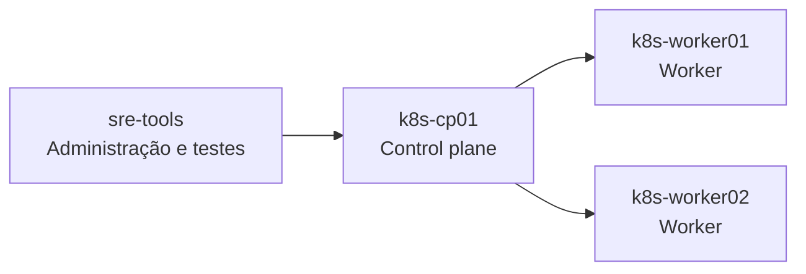

# Criar as máquinas virtuais

O laboratório inicial usa quatro VMs com Ubuntu Server LTS: um control plane, dois workers e uma máquina de ferramentas. Use a mesma versão do Ubuntu em todas. Os recursos abaixo são o ponto de partida para cargas pequenas e cabem nos 20 GB de RAM disponíveis, deixando margem para o Windows e picos de uso.

| VM | Função | vCPU | RAM | Disco |
| --- | --- | ---: | ---: | ---: |
| `k8s-cp01` | Control plane: API, scheduler, controllers e etcd | 2 | 2 GB | 40 GB |
| `k8s-worker01` | Executar aplicações e componentes do cluster | 2 | 4 GB | 60 GB |
| `k8s-worker02` | Executar aplicações e componentes do cluster | 2 | 4 GB | 60 GB |
| `sre-tools` | Ferramentas de administração, geração de carga e testes | 1 | 2 GB | 30 GB |
| **Total** |  | **7** | **12 GB** | **190 GB provisionados** |

Os discos podem ser dinâmicos, então o espaço ocupado no host cresce conforme os dados são gravados. Comece com memória fixa para que os testes de capacidade sejam previsíveis. A VM `sre-tools` é uma máquina de apoio e não precisa entrar no cluster Kubernetes.

### 1.1 Escolher o hypervisor

- No Windows Pro ou Enterprise, use Hyper-V.
- No Windows Home, use VirtualBox, pois o Hyper-V não está disponível nessa edição.
- Confirme na BIOS/UEFI que a virtualização de hardware AMD-V/SVM está habilitada.

Referências: [requisitos e instalação do Hyper-V](https://learn.microsoft.com/en-us/windows-server/virtualization/hyper-v/get-started/install-hyper-v) e [manual do VirtualBox](https://www.virtualbox.org/manual/ch01.html).

### 1.2 Criar as quatro VMs

Crie uma VM por linha da tabela de recursos. Em cada uma:

1. Defina o nome exatamente como indicado (`k8s-cp01`, `k8s-worker01`, `k8s-worker02` ou `sre-tools`).
2. Aloque a quantidade indicada de vCPUs e memória.
3. Crie um disco virtual com a capacidade indicada; disco de expansão dinâmica é adequado para este laboratório.
4. Anexe a ISO do Ubuntu Server LTS escolhido e instale o sistema operacional.
5. Atribua um endereço MAC e um identificador únicos à VM. Mantenha os valores registrados para evitar duplicidade ao clonar ou recriar máquinas.
6. Conecte o adaptador de rede virtual de cada VM ao switch/rede que será usado pelo laboratório.

Durante a instalação, use um nome de host correspondente ao nome da VM e crie uma conta administrativa com acesso `sudo`. Instale a edição Server, sem ambiente gráfico, para reduzir o consumo de recursos. Repita a mesma versão do Ubuntu nas quatro máquinas.

> A configuração de endereços IP, rede entre VMs, acesso SSH e validação de conectividade será documentada em uma seção posterior deste guia.

### 1.3 Conferir o resultado

Antes de avançar, confirme que as quatro VMs foram criadas, inicializam pelo disco instalado e têm os recursos planejados. Verifique também que cada uma possui nome, MAC e identificador exclusivos e que todas estão ligadas à rede virtual escolhida.

