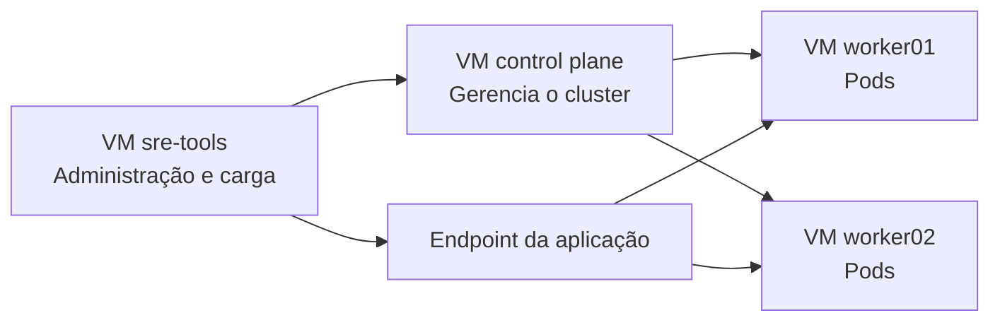

# SRE - Ambiente de Estudos

Status: In progress
Created At: 30/10/2026

Para o seu cenário — **Windows, processador AMD e 20 GB de RAM livres** — recomendo começar com **Kubernetes instalado com kubeadm em três VMs Linux**: um control plane e dois workers.

Isso permite estudar instalação, rede, distribuição de Pods, capacidade e falhas de máquinas. O foco SRE será observar como o serviço se comporta, detectar problemas e recuperar a operação.

## 1. Monte um laboratório que possa crescer

Comece com esta distribuição. Os recursos são um ponto de partida para cargas pequenas:

| VM | Função | vCPU | RAM | Disco |
| --- | --- | --- | --- | --- |
| `k8s-cp01` | API, scheduler, controllers e etcd | 2 | 2 GB | 40 GB |
| `k8s-worker01` | Aplicações e componentes do cluster | 2 | 4 GB | 60 GB |
| `k8s-worker02` | Aplicações e componentes do cluster | 2 | 4 GB | 60 GB |
| `sre-tools` | kubectl, Helm, geração de carga e testes | 1 | 2 GB | 30 GB |
| **Total** |  | **7** | **12 GB** | **190 GB provisionados** |

Os 8 GB restantes dão margem para crescimento, ferramentas e picos de uso. Discos dinâmicos podem ocupar menos espaço inicialmente.

Use **Ubuntu Server LTS**, com a mesma versão nas quatro VMs. Comece com RAM fixa para tornar os testes de capacidade mais previsíveis.

No Windows Pro ou Enterprise, prefira **Hyper-V**. No Windows Home, use **VirtualBox**, pois a função Hyper-V não está disponível nessa edição. Confira se a virtualização AMD-V/SVM está habilitada na BIOS/UEFI. [Requisitos e instalação do Hyper-V](https://learn.microsoft.com/en-us/windows-server/virtualization/hyper-v/get-started/install-hyper-v), [VirtualBox](https://www.virtualbox.org/manual/ch01.html).



**Limite importante do laboratório:** as VMs simulam máquinas diferentes, mas compartilham CPU, disco e host físico. Você consegue simular a perda de um nó; a perda do Windows derruba todo o ambiente.

## 2. Prepare a infraestrutura antes de instalar Kubernetes

Configure uma rede em que o Windows e as VMs possam se comunicar, com acesso à internet para baixar pacotes e imagens.

No Hyper-V, uma opção é um **switch interno com NAT**. No VirtualBox, você pode usar uma interface NAT para internet e outra host-only para o laboratório. Com duas interfaces, configure explicitamente qual IP o Kubernetes deve usar para comunicação entre nós.

Siga esta ordem:

1. Crie as VMs com nomes, MACs e identificadores únicos.
2. Configure IPs estáveis e sincronização de horário.
3. Valide SSH e comunicação entre todas as máquinas.
4. Instale `containerd` e configure o driver de cgroups compatível com o kubelet.
5. Desative swap para simplificar o primeiro laboratório.
6. Instale versões compatíveis de `kubeadm`, `kubelet` e `kubectl`.
7. Inicialize o control plane com `kubeadm init`.
8. Instale um CNI — recomendo **Calico**, incluindo suporte a NetworkPolicy.
9. Adicione os workers com `kubeadm join`.
10. Configure o acesso ao cluster na VM `sre-tools`.

Escolha redes de Pods e Services que não se sobreponham à rede das VMs, da sua casa ou da VPN. A configuração de rede do CNI precisa corresponder à configuração do cluster.

Use os procedimentos oficiais para a instalação, selecionando uma versão suportada em vez de copiar comandos antigos: [instalar kubeadm](https://kubernetes.io/docs/setup/production-environment/tools/kubeadm/install-kubeadm/) e [criar o cluster](https://kubernetes.io/docs/setup/production-environment/tools/kubeadm/create-cluster-kubeadm/).

**Critério para avançar:** todos os nós estão `Ready`, o DNS funciona e Pods em workers diferentes conseguem se comunicar.

```
kubectl get nodes -o wide
kubectl get pods -A -o wide
```

## 3. Estude os recursos nesta sequência

Uma trilha de **oito semanas**, com aproximadamente 5–7 horas semanais, é um bom ponto de partida.

| Semana | Estudo | Exercício e resultado esperado |
| --- | --- | --- |
| 1 | Linux, processos, CPU, memória, DNS e containers | Inspecionar um container, seus logs e consumo de recursos |
| 2 | Arquitetura Kubernetes e kubeadm | Montar o cluster e explicar a função de cada componente |
| 3 | Pods, Deployments, Services e probes | Publicar uma aplicação com duas réplicas e substituir uma versão |
| 4 | Requests, limits e scheduling | Reproduzir `Pending`, `OOMKilled` e contenção de CPU |
| 5 | HPA e capacidade | Gerar carga, observar crescimento e redução das réplicas |
| 6 | Helm charts | Empacotar a aplicação, fazer upgrade e rollback |
| 7 | Observabilidade e SLOs | Criar dashboard, indicadores e alertas |
| 8 | Incidentes e recuperação | Executar falhas controladas e escrever um postmortem |

Para os primeiros exercícios, use uma aplicação stateless. Depois avance para volumes, StatefulSets e recuperação de dados.

Algumas distinções precisam ficar claras:

| Recurso | O que você deve entender |
| --- | --- |
| **Pod** | Unidade de execução; pode conter mais de um container |
| **Deployment** | Mantém réplicas e controla atualizações de Pods |
| **Service** | Oferece um endpoint estável para acessar os Pods |
| **Readiness probe** | Indica se o Pod pode receber tráfego |
| **Liveness probe** | Detecta uma condição que justifica reiniciar o container |
| **Startup probe** | Protege aplicações com inicialização demorada |
| **Request** | Informa recursos usados nas decisões de agendamento |
| **Limit** | Restringe o consumo; CPU pode sofrer throttling e memória pode causar OOM |
| **Helm chart** | Pacote parametrizado de recursos Kubernetes |

Um exercício essencial: **apague um Pod gerenciado por Deployment e observe sua substituição**. Depois desligue um worker e compare os tempos de detecção e recuperação.

## 4. Separe os três tipos de autoscaling

| Mecanismo | O que muda | Exercício no laboratório |
| --- | --- | --- |
| **HPA** | Número de réplicas | Aumentar de 2 para até 6 Pods conforme a demanda |
| **VPA** | Recursos solicitados pelos Pods | Começar pelo modo de recomendação de CPU e memória |
| **Autoscaling de nós** | Quantidade de máquinas no cluster | Adicionar capacidade quando Pods não conseguem ser agendados |

O **HPA não cria máquinas virtuais**. Ele pode aumentar as réplicas e deixá-las em `Pending` quando os workers não têm capacidade.

Para criar VMs automaticamente, você precisa de um autoscaler integrado à infraestrutura, como uma implementação compatível com Cluster Autoscaler e seu provedor. No primeiro laboratório, adicione um worker manualmente para compreender o mecanismo. [Autoscaling de nós](https://kubernetes.io/docs/concepts/cluster-administration/node-autoscaling/).

Para HPA baseado em CPU/memória, instale **Metrics Server** e valide:

```
kubectl top nodes
kubectl top pods -A
```

Metrics Server atende à API de métricas de recursos. Para histórico, dashboards e alertas, use uma solução de monitoramento como Prometheus. [Documentação do Metrics Server](https://github.com/kubernetes-sigs/metrics-server).

### Primeiro exercício de HPA

Com Metrics Server funcionando, use a aplicação do tutorial oficial:

```
kubectl create namespace lab-sre
kubectl apply -n lab-sre -f https://k8s.io/examples/application/php-apache.yaml
```

Salve este conteúdo como `hpa.yaml`:

```
apiVersion: autoscaling/v2
kind: HorizontalPodAutoscaler
metadata:
  name: php-apache
  namespace: lab-sre
spec:
  scaleTargetRef:
    apiVersion: apps/v1
    kind: Deployment
    name: php-apache
  minReplicas: 2
  maxReplicas: 6
  metrics:
    - type: Resource
      resource:
        name: cpu
        target:
          type: Utilization
          averageUtilization: 60
  behavior:
    scaleDown:
      stabilizationWindowSeconds: 300
```

Aplique e acompanhe em terminais separados:

```
kubectl apply -f hpa.yaml
kubectl get hpa -n lab-sre -w
kubectl get pods -n lab-sre -o wide -w
```

O exemplo oficial solicita `200m` de CPU por Pod. Portanto, o alvo de 60% corresponde a aproximadamente **120m de CPU por Pod**, e não a 60% da CPU inteira da VM.

Siga a etapa de geração de carga do [tutorial oficial de HPA](https://kubernetes.io/docs/tasks/run-application/horizontal-pod-autoscale-walkthrough/). Depois exponha a aplicação por NodePort ou por um controlador de entrada e gere carga a partir da VM `sre-tools`.

Registre quatro medidas:

- Tempo entre aumento de carga e aumento das réplicas.
- Tempo até os novos Pods ficarem prontos.
- Erros e latência durante esse intervalo.
- Tempo para reduzir réplicas após encerrar a carga.

A utilização é calculada em relação aos **requests**. Requests inadequados distorcem o comportamento do HPA. [Funcionamento do HPA](https://kubernetes.io/docs/tasks/run-application/horizontal-pod-autoscale/).

## 5. Transforme sua aplicação em um Helm chart

Aprenda primeiro os manifests Kubernetes; depois transforme-os em templates.

A estrutura inicial pode ser:

```
sre-api/
├── Chart.yaml
├── values.yaml
└── templates/
    ├── deployment.yaml
    ├── service.yaml
    ├── hpa.yaml
    └── pdb.yaml
```

| Arquivo | Responsabilidade |
| --- | --- |
| `Chart.yaml` | Nome, versão do chart e versão da aplicação |
| `values.yaml` | Valores padrão: imagem, recursos, portas e autoscaling |
| `templates/` | Manifests gerados a partir dos valores |

**Versão do chart e versão da aplicação são conceitos separados.** [Estrutura de charts](https://helm.sh/docs/topics/charts/).

Comece pelo scaffold e adapte-o:

```
helm create sre-api
helm lint ./sre-api
helm template sre-api ./sre-api
helm upgrade --install sre-api ./sre-api -n lab-sre --wait --timeout 5m
helm history sre-api -n lab-sre
```

Faça uma segunda atualização e pratique voltar à revisão anterior:

```
helm rollback sre-api 1 -n lab-sre --wait --timeout 5m
```

Quando o HPA estiver habilitado, configure o template para omitir `spec.replicas` do Deployment. Isso evita que atualizações do chart reponham uma quantidade fixa de réplicas.

Seu chart deve permitir configurar imagem, requests/limits, probes, autoscaling e distribuição entre nós. Use os comandos da versão instalada do Helm: [upgrade](https://helm.sh/docs/helm/helm_upgrade/) e [rollback](https://helm.sh/docs/helm/helm_rollback/).

## 6. Dê aos exercícios um objetivo de confiabilidade

Instale gradualmente **Prometheus, Grafana, Alertmanager e kube-state-metrics**, por exemplo por um chart que reúna esses componentes. Comece com retenção curta e acompanhe o consumo dos workers.

Seu dashboard precisa responder:

| Pergunta | Indicadores |
| --- | --- |
| O serviço atende bem? | Taxa de requisições, erros e latência |
| Estamos perto do limite? | CPU, memória, throttling e capacidade alocável |
| Kubernetes consegue manter a aplicação? | Réplicas desejadas/disponíveis, reinícios, Pods `Pending` e nós `NotReady` |
| O autoscaling acompanha a demanda? | Métrica do HPA, réplicas atuais e limite máximo |

Defina objetivos de laboratório, por exemplo:

- **Disponibilidade:** 99,9% das requisições elegíveis têm sucesso.
- **Latência:** 99% das requisições elegíveis terminam em até 300 ms.
- **Janela inicial:** 24 horas de experimentos.

Defina o que significa “requisição elegível” e “sucesso”. No SLO de disponibilidade acima, o error budget corresponde a **0,1% das requisições elegíveis**.

Faça uma verificação externa na VM `sre-tools`: métricas da aplicação podem deixar de registrar falhas que impedem a requisição de chegar até ela. [Implementando SLOs — Google SRE Workbook](https://sre.google/workbook/implementing-slos/).

## 7. Pratique incidentes com hipóteses e evidências

Execute um cenário por vez, mantendo tráfego e observabilidade ativos.

| Cenário | O que investigar |
| --- | --- |
| Apagar um Pod | Substituição e impacto nas requisições |
| Desligar um worker | Detecção de `NotReady`, distribuição e recuperação |
| Desligar o control plane único | Pods existentes podem continuar; reconciliação e gerenciamento ficam indisponíveis |
| Publicar uma imagem inválida | `ImagePullBackOff`, rollout bloqueado e rollback |
| Configurar readiness incorreta | Pods em execução que não recebem tráfego |
| Exceder o limite de memória | `OOMKilled`, reinícios e perda de disponibilidade |
| Pedir recursos acima da capacidade | `Pending` e eventos de agendamento |
| Fazer drain com PDB | Proteção durante manutenção e possíveis bloqueios |
| Gerar carga acima do máximo do HPA | Saturação mesmo com o autoscaling funcionando |
| Usar volume local e perder o nó | Diferença entre recuperar o Pod e recuperar seus dados |

Tenha estes comandos à mão:

```
kubectl get pods -A -o wide
kubectl describe pod <pod> -n lab-sre
kubectl logs <pod> -n lab-sre --previous
kubectl get events -n lab-sre --sort-by=.metadata.creationTimestamp
kubectl describe hpa php-apache -n lab-sre
kubectl describe node k8s-worker01
```

Para manutenção planejada, depois de configurar réplicas, distribuição e PDB:

```
kubectl drain k8s-worker01 --ignore-daemonsets
kubectl uncordon k8s-worker01
```

O PDB limita certas interrupções **voluntárias**; ele não impede que uma VM falhe.

Para cada incidente, produza um registro curto: hipótese, impacto esperado, linha do tempo, sinais observados, recuperação e melhoria proposta.

## 8. Avance para alta disponibilidade e automação

Quando dominar o ambiente inicial, amplie para **três control planes com etcd empilhado e um balanceador para a API**. Com VMs pequenas, essa etapa pode caber nos seus 20 GB livres, mas exige reduzir cargas e observar o consumo.

Três membros de etcd permitem manter quorum após perder um membro. O endpoint de acesso à API também precisa permanecer disponível. [Cluster de alta disponibilidade com kubeadm](https://kubernetes.io/docs/setup/production-environment/tools/kubeadm/high-availability/).

Nessa etapa, pratique:

- Backup e restauração do etcd; recuperação de volumes é um exercício separado.
- Upgrade do cluster e manutenção de um nó por vez.
- RBAC, NetworkPolicy e políticas de segurança dos Pods.
- Provisionamento repetível com cloud-init/Ansible.
- Autoscaling real de nós em uma infraestrutura com integração suportada.

**Seu projeto final:** uma aplicação instalada por Helm, distribuída entre workers, com HPA, dashboard, SLO, alerta, procedimento de rollback e evidências de recuperação após perder um worker. Esse conjunto demonstra competências práticas de operação e confiabilidade com foco em SRE.

# Aplicação

**Rode o [podinfo](https://github.com/stefanprodan/podinfo) primeiro.** É uma aplicação pequena, com interface web, API, métricas e endpoints para simular falhas. Ela permite estudar Kubernetes e SRE sem precisar desenvolver uma aplicação antes.

Minha sugestão é evoluir por três cenários:

| Etapa | Aplicação | O que estudar |
| --- | --- | --- |
| **1. Fundamentos** | podinfo com duas réplicas | Pods, Service, probes, Helm, rollout e recuperação |
| **2. Dependências** | Duas instalações do podinfo, uma chamando a outra, mais Redis | Comunicação entre serviços, cache, timeouts e falhas de dependências |
| **3. Ambiente maior** | [Online Boutique, do Google](https://github.com/GoogleCloudPlatform/microservices-demo) | Uma loja virtual com 11 microsserviços: investigar gargalos e falhas entre serviços |

Para seus recursos disponíveis, eu começaria pela primeira etapa.

Com o cluster e o **Metrics Server** funcionando, salve este arquivo como `podinfo-values.yaml`:

```
replicaCount: 2

service:
  type: NodePort
  nodePort: 31198

resources:
  requests:
    cpu: 100m
    memory: 64Mi
  limits:
    cpu: 500m
    memory: 256Mi

hpa:
  enabled: true
  cpu: 60
  maxReplicas: 6
```

Esse chart usa `replicaCount` como mínimo do HPA: você terá entre **2 e 6 réplicas**, com alvo de CPU em 60% do request. [Valores do chart oficial](https://github.com/stefanprodan/podinfo/blob/master/charts/podinfo/values.yaml).

Execute na VM `sre-tools`, com Helm e acesso ao cluster configurados:

```
helm repo add podinfo https://stefanprodan.github.io/podinfo
helm repo update
helm upgrade --install podinfo podinfo/podinfo --namespace lab-sre --create-namespace --values podinfo-values.yaml --wait --timeout 5m
```

No Windows, abra `http://IP_DO_WORKER:31198`, substituindo pelo IP de um worker acessível na rede do laboratório.

A aplicação oferece estes endpoints para exercícios:

| Endpoint | Experimento |
| --- | --- |
| `/` | Ver informações da instância que respondeu |
| `/version` | Confirmar a versão após um upgrade |
| `/healthz` e `/readyz` | Entender probes |
| `/delay/3` | Introduzir três segundos de latência |
| `/status/500` | Gerar respostas de erro |
| `/panic` | Derrubar o processo e observar seu reinício |
| `/metrics` | Consultar métricas da aplicação |

Esses comportamentos estão documentados no [projeto podinfo](https://github.com/stefanprodan/podinfo#readme).

**Faça o primeiro exercício com tráfego contínuo:** apague um Pod, acompanhe sua substituição e meça os erros e a latência durante a recuperação. Depois repita desligando um worker.

Para demonstrar **HPA por CPU**, mantenha também o `php-apache` do [tutorial oficial do Kubernetes](https://kubernetes.io/docs/tasks/run-application/horizontal-pod-autoscale-walkthrough/). Ele facilita esse teste: o podinfo é leve, e adicionar latência com `/delay/3` não significa consumir muita CPU.

A progressão que recomendo é: **podinfo → podinfo com backend e Redis → Online Boutique**, mantendo dashboards e testes de carga em cada etapa.